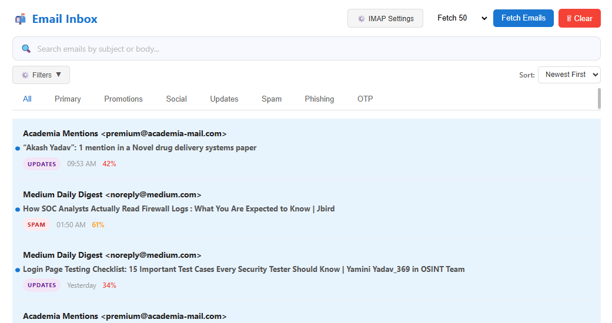
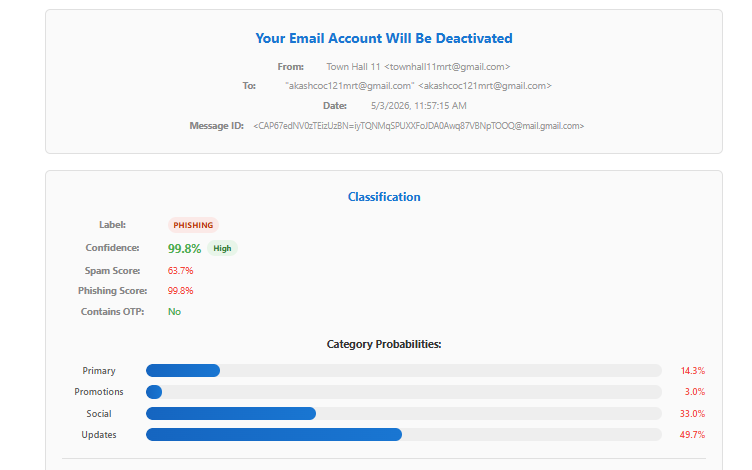
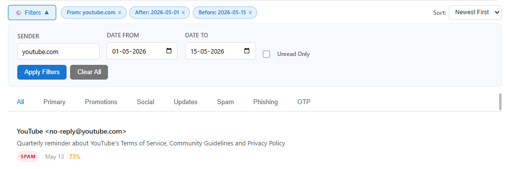
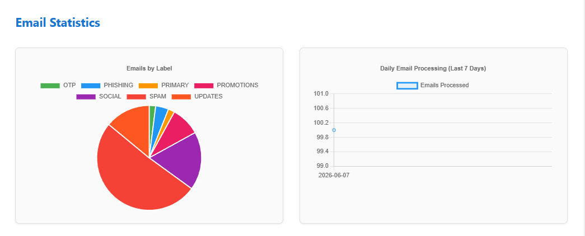
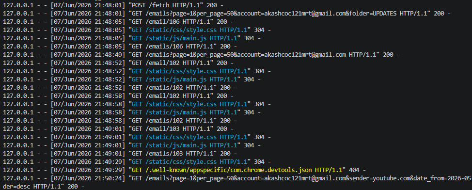

# Email Intelligence System

A machine learning based email classification system built as a major project. It connects to any IMAP-compatible mailbox, fetches emails, and classifies them using three independent ML models combined through a rule-based decision engine. Results are shown on a Flask web dashboard.

Tested with Gmail. Works with any mail provider that supports IMAP (Outlook, Yahoo, Zoho, and others).

> Major Project - Academic Project

---

## Overview

Most email providers handle spam/phishing filtering as a black box. The user never sees why something was flagged. This project takes the opposite approach: every email is scored individually by three separate models (phishing, spam, category), and those scores are combined through a transparent rule engine to produce one final label. The user can see the exact confidence score behind every decision.

### How it works, end to end

1. **Fetch** - Emails are pulled from the user's mailbox over IMAP
2. **Parse** - Raw email (headers, body, attachments) is parsed into a structured object
3. **Feature Extraction** - 15 handcrafted numerical features are computed from each email (no TF-IDF, no embeddings)
4. **Prediction** - Three models run independently on the same feature vector:
   - XGBoost -> phishing probability
   - Random Forest -> spam probability
   - Random Forest -> category probabilities (Primary / Promotions / Social / Updates)
5. **Rule Engine** - Combines all three predictions using priority logic and a trusted domain reputation check to produce one final label
6. **Storage** - Email, classification, and feedback data saved to SQLite (3 tables)
7. **Display** - Flask dashboard shows inbox, per-email breakdown, filters, and statistics

---

## Setup & Installation

### 1. Clone the repository

```bash
git clone https://github.com/akasH-yad-aV/email-intelligence-system.git
cd email-intelligence-system
```

### 2. Install dependencies

```bash
pip install -r requirements.txt
```

### 3. Create your `.env` file from the template

```bash
# Linux / Mac
cp .env.template .env
```

```
# Windows
copy .env.template .env
```

### 4. Configure your IMAP credentials

Open your `.env` file and set these values:

```env
IMAP_SERVER=imap.your-provider.com
IMAP_USERNAME=your-email@example.com
IMAP_PASSWORD=your-app-specific-password
```

Most providers require an app-specific password rather than your real account password, especially if 2FA is enabled.

**Common IMAP servers:**

| Provider | IMAP Server |
|---|---|
| Gmail | `imap.gmail.com` |
| Outlook / Hotmail | `outlook.office365.com` |
| Yahoo Mail | `imap.mail.yahoo.com` |
| Zoho Mail | `imap.zoho.com` |

For step-by-step instructions including how to generate a Gmail App Password, see [ENV_SETUP.md](./ENV_SETUP.md)

### 5. Train the models

The prepared training CSVs are included in the repository. Run the training scripts to generate the model files:

```bash
python -m models.train_phishing
python -m models.train_spam
python -m models.train_category
```

### 6. Run the application

```bash
python -m api.app
```

The dashboard will be available at `http://127.0.0.1:5000`

---

## Datasets

### Phishing Model Datasets

The phishing model was trained on real email corpora. All six datasets below are available from a single Kaggle collection: [Phishing Email Dataset](https://www.kaggle.com/datasets/naserabdullahalam/phishing-email-dataset)

| Dataset | Role in Training |
|---|---|
| CEAS_08 | Phishing samples + legitimate samples |
| Nigerian Fraud | Phishing samples only |
| Nazario | Phishing samples only |
| Ling | Phishing samples + legitimate samples |
| Enron | Legitimate samples only (label=0 rows) |
| SpamAssassin | Legitimate ham samples |

The raw SpamAssassin email corpus is also available separately at [Apache SpamAssassin Public Corpus](https://spamassassin.apache.org/old/publiccorpus/)

Preparation script: `data/prepare_phishing.py`

### Spam Model Datasets

The spam model was trained on a combination of real and synthetic data.

| Dataset | Role in Training |
|---|---|
| SpamAssassin corpus (spam, spam_2 folders) | Spam samples |
| SpamAssassin corpus (easy_ham, hard_ham folders) | Ham (legitimate) samples |
| Email Classification 1M (synthetic CSV) | Additional spam and ham samples |

The synthetic CSV is available at [Kaggle - Email Spam Classification](https://www.kaggle.com/datasets/sharmajicoder/email-spam-classification)

Preparation script: `data/prepare_spam.py`

### Category Model Dataset

The category model was trained entirely on the synthetic CSV dataset.

| Dataset | Labels Used |
|---|---|
| Email Classification 1M | Primary, Promotions, Social, Updates |

Source: [Kaggle - Email Spam Classification](https://www.kaggle.com/datasets/sharmajicoder/email-spam-classification)

Preparation script: `data/prepare_category.py`

### Retrain from Raw Datasets

If you want to retrain from the original raw datasets instead of the included CSVs, place the raw data in the expected directories (see preparation scripts for exact paths), then run:

```bash
python -m data.prepare_phishing
python -m data.prepare_spam
python -m data.prepare_category

python -m models.train_phishing
python -m models.train_spam
python -m models.train_category
```

---

## ML Models

### Model 1 - Phishing Detection
- **Algorithm:** XGBoost
- **Task:** Binary classification (phishing / not phishing)
- **Note:** Tuned aggressively to maximize phishing recall. This caused a higher false positive rate on legitimate senders, which is why the trusted domain reputation system exists (see Rule Engine below)

### Model 2 - Spam Detection
- **Algorithm:** Random Forest
- **Task:** Binary classification (spam / not spam)

### Model 3 - Category Classification
- **Algorithm:** Random Forest
- **Task:** Multi-class classification (Primary, Promotions, Social, Updates)
- **Accuracy:** ~55% - limited by dataset size and diversity, a known constraint of this academic project

---

## Feature Engineering

15 handcrafted features computed per email. No TF-IDF, no text embeddings.

This was a deliberate choice: handcrafted numerical features are faster to compute, fully interpretable, and make the rule engine decisions explainable.

| # | Feature | Description |
|---|---|---|
| 01 | `num_links` | Count of URLs/hyperlinks in body |
| 02 | `num_attachments` | Number of attached files |
| 03 | `has_urgent_words` | Binary: presence of urgent/immediate/act-now language |
| 04 | `has_spam_words` | Binary: presence of free/winner/offer/prize keywords |
| 05 | `has_phishing_words` | Binary: presence of verify/account/suspend keywords |
| 06 | `contains_html` | Binary: HTML tags detected in body |
| 07 | `email_length` | Character count of full body text |
| 08 | `num_exclamations` | Count of exclamation marks |
| 09 | `num_uppercase_words` | Count of ALL-CAPS words |
| 10 | `day_of_week` | Temporal feature (0=Mon, 6=Sun) |
| 11 | `hour` | Hour of receipt (0-23) |
| 12 | `is_reply` | Binary: RE: prefix in subject line |
| 13 | `is_forward` | Binary: FWD: prefix in subject line |
| 14 | `sender_reputation` | Trust score from domain registry (0-1) |
| 15 | `contains_otp` | Regex match for OTP/code/token patterns |

---

## Rule Engine

The three models produce independent predictions. The rule engine combines them into one final label using priority-based logic:

```
Priority Order:
1. OTP       - if OTP signals detected, classify as OTP regardless of other scores
2. Phishing  - if phishing score is high AND sender domain is NOT trusted -> PHISHING
3. Spam      - if spam score is high -> SPAM
4. Category  - otherwise, use the category model predicted class
```

### Trusted Domain Reputation System

The phishing model was flagging legitimate emails from senders like Adobe and Google as phishing with 98%+ confidence. To fix this without retraining the model, a JSON-based registry of 5000+ known domains with reputation scores was added.

If the phishing score is high but the sender domain is trusted with a sufficient reputation score, the email is downgraded to Spam instead of Phishing. This significantly reduced false positives without sacrificing detection on unknown or untrusted senders.

---

## Database Schema

Three SQLite tables:

**emails** - Parsed email data: ID, sender, recipient, subject, body, timestamp

**classifications** - All model outputs per email: phishing score, spam score, category probabilities, OTP flag, final label, confidence

**feedback** - User relabel actions: old label, new label, notes. Enables future retraining with corrected ground truth.

---

## Dashboard Features

- **Inbox View** - all emails with label badge and confidence at a glance
- **Category Tabs** - All / Primary / Promotions / Social / Updates / Spam / Phishing / OTP
- **Filter System** - filter by sender, date range, unread status
- **Detailed Email View** - full classification breakdown per email
- **Statistics Dashboard** - distribution pie chart and daily processing trend
- **Manual Relabeling** - correct a wrong classification, stored as feedback

---

## Screenshots

### Inbox View


### Detailed Email Classification


### Filter System


### Statistics Dashboard


### Backend Logs


---

## Tech Stack

| Component | Technology |
|---|---|
| Email Fetching | IMAP |
| Phishing Model | XGBoost |
| Spam and Category Models | Random Forest (scikit-learn) |
| Rule Engine | Custom Python logic |
| Trusted Domain Registry | JSON (5000+ entries) |
| Database | SQLite |
| Web Framework | Flask |
| Language | Python |

---

## Known Limitations

| Limitation | Status |
|---|---|
| Phishing model false positives on trusted senders | Mitigated via sender reputation engine |
| Category model ~55% accuracy | Known - dataset size and diversity constraint |
| Binary phishing model only | Planned: extend to multi-class including spam |
| Manual fetch only, no real-time monitoring | Planned improvement |

---

## Future Improvements

- Extend phishing model to multi-class classification (phishing and spam combined)
- Expand trusted domain registry
- Add real-time IMAP polling
- Improve category model with a larger dataset
- Add DKIM / SPF / DMARC header validation as additional features